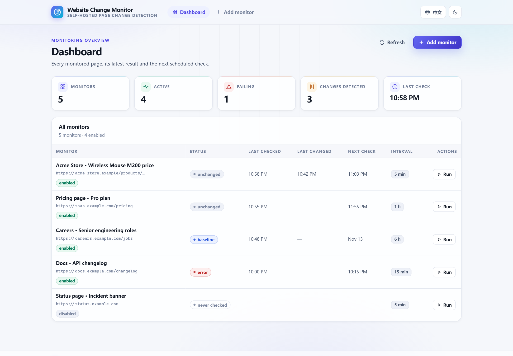
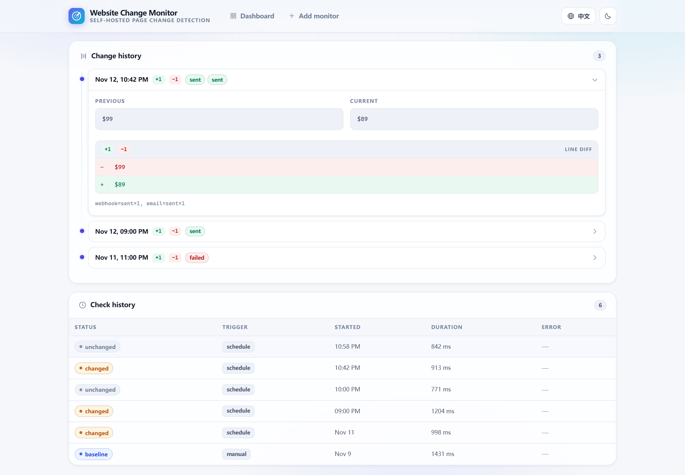

# Website Change Monitor

A small, self-hosted service that watches public web pages for content changes. Give it a URL, a selector for the part you care about and an interval — it extracts, normalizes, hashes and compares the content on a schedule, records every check in SQLite, and sends a webhook and/or an email when something actually changed.

**English** | [简体中文](README.zh-CN.md)



The web UI ships in English and Chinese, with light and dark themes. Language and theme are switchable from the header and remembered per browser.

## What it does

- **Monitors** — create, edit, enable/disable, delete and run on demand. Each monitor has a URL, a selector, a selector type, an interval and optional webhook/email targets.
- **Three selector types** — CSS, XPath, or plain-text matching (every body line containing your text).
- **Real browser extraction** — one shared Chromium with crash recovery and an isolated context per check; images, media and fonts are skipped.
- **Two SSRF protection layers** — a literal-IP URL guard plus DNS A/AAAA checks, applied at monitor creation, before every check, and to every webhook target. Redirects are followed manually and re-validated at each hop.
- **Noise-resistant detection** — content is normalized (line endings, whitespace, empty lines) and SHA-256 hashed; only real changes produce events.
- **Honest change history** — every genuine transition gets its own event with previous/current content and a line diff. `A → B → A` is real history, not a duplicate; repeated identical polls stay silent.
- **Baseline semantics** — the first successful check stores a baseline and never notifies.
- **Full check history** — every attempt (success or failure) is recorded with status, duration and a safe error code.
- **Notifications** — JSON webhook (bounded retries) and SMTP email, each with its own delivery record. A failed notification never fails the check.
- **Bounded scheduler** — global concurrency limit, per-monitor re-entrancy guard, restart-safe (state derived from the database) and graceful shutdown that drains in-flight work.
- **Snapshot retention** — `MAX_SNAPSHOTS_PER_MONITOR` prunes old snapshots; change events are never pruned.
- **Optional API key** — set `APP_API_KEY` to require `Authorization: Bearer <key>` on every API route except `/health` (timing-safe comparison).
- **Test extraction** — preview exactly what would be monitored before saving, with nothing persisted.
- **Offline by default** — the demo and the whole test suite run against local fixtures, never the internet.

Typical uses: product prices and stock on public shop pages, job postings, documentation or policy updates, public competitor pages, and any public page where a specific block of text matters.

## Quick start

Requirements: Node.js 22 or 24, npm 10+, and Playwright Chromium.

```bash
git clone https://github.com/taozhihaoo/website-change-monitor.git
cd website-change-monitor
npm install
npx playwright install chromium
cp .env.example .env      # optional — defaults work out of the box
```

Run it:

```bash
npm run dev       # API + built UI on http://localhost:3000
npm run dev:web   # optional Vite dev server for UI work (proxies the API)
```

Production:

```bash
npm run build
npm start         # serves API + built UI on http://localhost:3000
```

Try the whole pipeline offline against a local fixture page (`$99 → $89`, change detection, mock notification, idempotency):

```bash
npm run demo
```

## How it works

```text
scheduler tick (every SCHEDULER_TICK_MS)
   └─ enabled + due + not already running
        └─ bounded queue (MAX_CONCURRENT_CHECKS)
             └─ check
                  URL guard + DNS guard
                  → Playwright (shared browser, isolated context, guarded requests)
                  → extract (css / xpath / text) → normalize → sha256
                  → compare with the latest snapshot
                       first run  → baseline (no notification)
                       same hash  → unchanged
                       different  → snapshot + change event + async notifications
```

Layers: `api/` (thin Fastify routes) · `services/` (business logic) · `repositories/` (parameterized SQL) · `browser/` (Playwright lifecycle) · `scheduler/` (tick loop + bounded queue) · `notifications/` (provider abstraction) · `db/` (SQLite + numbered migrations). The REST API and webhook payloads use `snake_case`; internal TypeScript uses `camelCase`.

Data model:

```text
monitors(id, name, url, selector, selector_type, check_interval_seconds,
         enabled, webhook_url, notify_email, created_at, updated_at)
snapshots(id, monitor_id→, content_hash, content, checked_at)
change_events(id, monitor_id→, previous_hash, current_hash,
              previous_content, current_content, diff_json, detected_at)
check_runs(id, monitor_id→, triggered_by, status, error_code, error_message,
           duration_ms, started_at, finished_at)
notification_deliveries(id, change_event_id→, monitor_id→, provider, target,
                        status, attempts, last_error, created_at, updated_at)
schema_migrations(version, applied_at)
```

## Configuration

All configuration is via environment variables (see `.env.example`). Secrets are never written to the database or logs.

| Variable | Default | Purpose |
| --- | --- | --- |
| `APP_PORT` | `3000` | HTTP port |
| `DB_PATH` | `data/wcm.db` | SQLite file (created on demand) |
| `LOG_LEVEL` | `info` | `fatal` … `trace`, or `silent` |
| `BROWSER_HEADLESS` | `true` | Chromium headless mode |
| `MAX_CONCURRENT_CHECKS` | `5` | Global concurrency limit |
| `DEFAULT_TIMEOUT` | `30000` | Per-page navigation/extraction budget (ms) |
| `EXTRACTION_SETTLE_MS` | `1000` | Extra wait for rendering after load |
| `SCHEDULER_TICK_MS` | `10000` | Scheduler tick interval |
| `WEBHOOK_TIMEOUT_MS` | `8000` | Webhook request timeout |
| `WEBHOOK_MAX_ATTEMPTS` | `3` | Retry attempts (network, 5xx, 429 only) |
| `DNS_TIMEOUT_MS` | `5000` | DNS guard timeout |
| `MAX_SNAPSHOTS_PER_MONITOR` | `100` | Retention per monitor (`0` = unlimited) |
| `APP_API_KEY` | unset | Require `Authorization: Bearer <key>` (≥ 16 chars) |
| `ALLOW_PRIVATE_TARGETS` | `false` | Allow localhost/private URLs — **dev, demo and tests only** |
| `DEFAULT_NOTIFICATION_PROVIDER` | `none` | Provider when a monitor has no target: `none` or `mock` |
| `SMTP_HOST` | unset | Enables the email provider |
| `SMTP_PORT` / `SMTP_SECURE` | `587` / `false` | SMTP connection |
| `SMTP_USER` / `SMTP_PASSWORD` / `SMTP_FROM` | unset | SMTP credentials; `SMTP_FROM` is required with `SMTP_HOST` |

## Selectors

| Type | Example | Meaning |
| --- | --- | --- |
| `css` | `.product-price` | Inner text of every matching element, joined |
| `xpath` | `//div[@class="price"]` | Same, located via XPath |
| `text` | `$99` | All body lines containing the text |

Failure modes are explicit error codes: `SELECTOR_NOT_FOUND`, `TEXT_NOT_FOUND`, `EMPTY_EXTRACTION`, `TIMEOUT`, `NAVIGATION_ERROR`, `NETWORK_ERROR`, `DNS_ERROR`. A failed check never disables a monitor.

Scheduling is per monitor, in seconds (UI presets from 5 minutes to 24 hours; the API accepts ≥ 60 s). Due-ness is derived from the last run's start time — including failures, which prevents error storms. A monitor never runs twice in parallel, and manual runs jump the queue.

## Notifications

A monitor can configure a webhook and an email address at the same time; each target gets its own delivery record and retry budget.

```json
{
  "event": "content_changed",
  "monitor_id": "…",
  "monitor_name": "Acme product price",
  "url": "https://example.com/product",
  "detected_at": "2026-09-30T05:04:19.343Z",
  "previous_hash": "735ad7c6…",
  "current_hash": "bcb852ad…",
  "diff": { "added": 1, "removed": 1, "changes": [ … ] }
}
```

- **webhook** — POSTs the payload above. Retries on network errors, timeouts, 5xx and 429 with exponential backoff; other 4xx fail immediately. Redirects are followed manually (max 3) with the URL and DNS guards re-applied to every hop.
- **email** — compact plain-text mail via SMTP: monitor, URL, detected time, hashes, diff summary and a bounded excerpt of changed lines. Never the full snapshot.
- **mock** — logs the payload; used by the demo and tests, or via `DEFAULT_NOTIFICATION_PROVIDER=mock`.

## REST API

When `APP_API_KEY` is set, every route below except `GET /health` requires a Bearer token.

| Method & Path | Purpose |
| --- | --- |
| `GET /health` | Liveness + scheduler snapshot (always public) |
| `GET /stats` | Dashboard aggregates |
| `GET /monitors` | List with last check / last change / next check |
| `POST /monitors` | Create (validated, URL + DNS guarded) → 201 |
| `GET /monitors/:id` | Detail with summary fields |
| `PATCH /monitors/:id` | Partial update |
| `DELETE /monitors/:id` | Delete (cascades history) → 204 |
| `POST /monitors/:id/run` | Run now → 202; `?wait=1` waits for the result |
| `GET /monitors/:id/runs` | Check history (paged) |
| `GET /monitors/:id/snapshots` | Snapshot history (paged) |
| `GET /monitors/:id/changes` | Change events with diff and deliveries |
| `GET /monitors/:id/notifications` | Notification deliveries (paged) |
| `POST /monitors/:id/test-notification` | Test every configured target |
| `POST /monitors/test-extraction` | Preview extraction — persists nothing |

Errors share one envelope and never leak stack traces:

```json
{ "error": { "code": "VALIDATION_ERROR", "message": "Request validation failed.", "details": { … } } }
```

`400` validation / blocked URL / DNS refusal · `401` missing or wrong API key · `404` unknown monitor · `409` monitor already checking · `413` oversized body · `422` extraction failure · `502` test notification failed · `500` safe internal error with a request id.

## Screenshots

| Dashboard | Change history and line diff |
| --- | --- |
|  |  |

Regenerate them from a real running instance:

```bash
npm run build && npm run screenshots
```

## Testing

The whole suite is offline — no internet, no real target sites, no real SMTP. 112 unit tests and 26 integration tests (real Chromium, local fixture server, real SQLite, Fastify `inject`):

```bash
npm test                  # unit tests
npm run test:integration  # real browser + fixture site
npm run check             # lint + typecheck + unit tests
node scripts/e2e-verify.mjs   # 26 checks against the built server
```

Type checking covers `src/`, `test/`, `scripts/` and the client workspace.

## Docker

```bash
docker compose up --build
```

Multi-stage build on Node 24 slim: compiles server and client, prunes dev dependencies, installs Chromium, runs as a non-root `app` user, keeps SQLite in the `wcm-data` volume and exposes a `/health`-based healthcheck. The Docker files have not been verified on a machine with Docker; CI builds and tests the application itself on every push.

## CI

GitHub Actions runs on Node 22 and 24: install → Playwright Chromium → lint → typecheck → unit tests → integration tests → build → end-to-end verification of the compiled server.

## Limitations

- **Single-user authentication** — `APP_API_KEY` is one shared key for one operator; there are no users, roles or sessions.
- **DNS rebinding (TOCTOU)** — the DNS guard resolves before the browser connects, so an adversarial DNS server can still return different answers per lookup. Egress filtering remains the complete answer.
- **No CAPTCHA or anti-bot handling** — by design. Sites that block bots yield `NAVIGATION_ERROR` / `NETWORK_ERROR`.
- **One process, one browser, one SQLite file** — no distributed workers; SQLite is intended for lightweight deployments.
- **Selectors are fragile** — page structure changes break extraction; the check history helps you notice.
- **Email has no queue beyond the per-event retry budget** — a long SMTP outage is recorded as a failed delivery and not re-sent.
- **Use only on public or authorized content** — respect robots.txt, terms of service, rate limits and applicable law. The default cadence is deliberately conservative, requests identify themselves with an honest user agent, and the project implements no CAPTCHA bypass, proxy rotation or fingerprint spoofing.

## License

MIT
