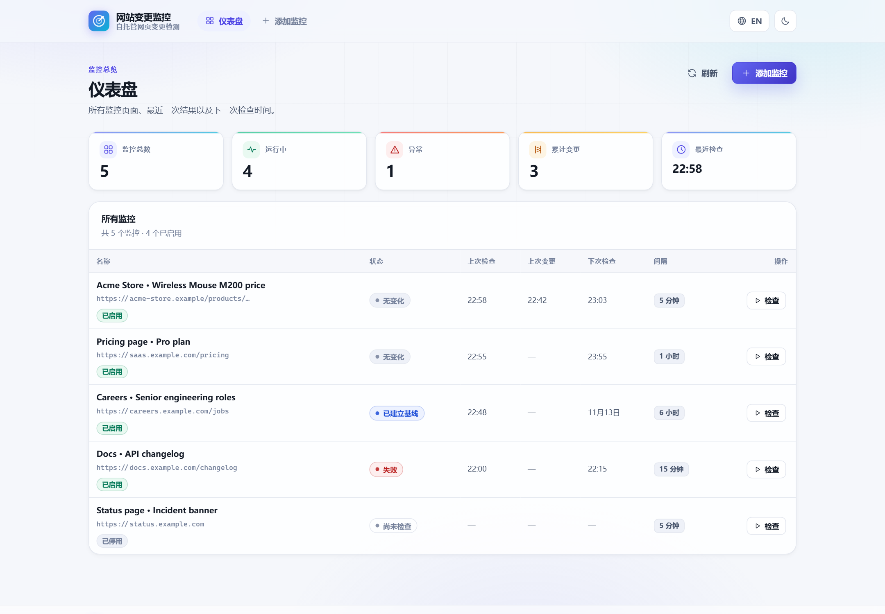
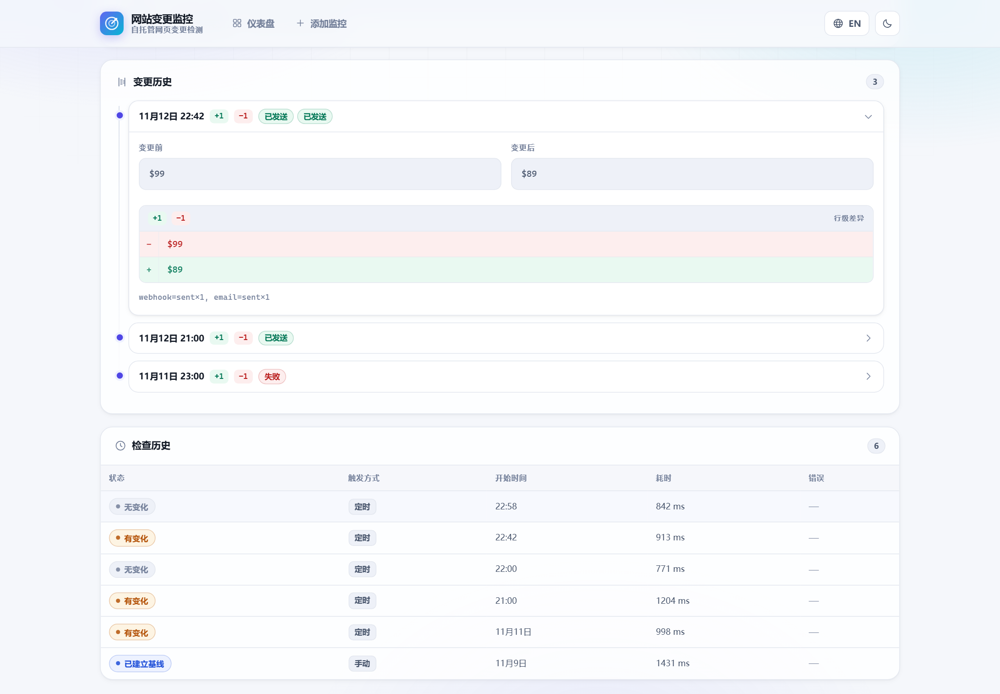

# 网站变更监控

一个小而完整的自托管服务，用来看守公开网页的内容变化。给它一个网址、一个选择器（你关心的那块内容）和一个检查间隔，它就会按计划抓取、规范化、哈希并比对内容，把每一次检查写入 SQLite，并在内容**真的**发生变化时发送 Webhook 和/或邮件。

[English](README.md) | **简体中文**



界面内置中文与英文，支持浅色/深色主题；语言和主题可在顶栏切换，并按浏览器记住选择。

## 它能做什么

- **监控项管理** —— 新建、编辑、启用/停用、删除、立即检查。每个监控项包含网址、选择器、选择器类型、检查间隔，以及可选的 Webhook / 邮件通知目标。
- **三种选择器** —— CSS、XPath，或纯文本匹配（返回正文中包含该文本的所有行）。
- **真实浏览器提取** —— 共享一个 Chromium 实例，崩溃后自动重启；每次检查使用独立上下文；跳过图片、媒体与字体。
- **两层 SSRF 防护** —— 字面 IP 校验 + DNS A/AAAA 解析校验，覆盖创建监控项、每次检查之前，以及所有 Webhook 目标。重定向手动跟随，且**每一跳**都重新校验。
- **抗噪的变更判定** —— 内容先规范化（换行符、空白、空行）再计算 SHA-256，只有真实变化才会产生事件。
- **诚实的变更历史** —— 每一次真实变化都会单独记录，包含变更前后内容与行级差异。`A → B → A` 是真实历史而不是重复；反复轮询到相同内容则保持静默。
- **基线语义** —— 首次成功检查只建立基线，不发送通知。
- **完整的检查历史** —— 每一次尝试（成功或失败）都会记录状态、耗时与安全的错误码。
- **通知** —— JSON Webhook（有限次重试）与 SMTP 邮件，各自有独立的投递记录。通知失败永远不会让检查失败。
- **有界调度器** —— 全局并发上限、单监控项重入保护、重启后自动恢复（状态来自数据库），关闭时排空进行中的任务。
- **快照保留** —— `MAX_SNAPSHOTS_PER_MONITOR` 会清理旧快照；变更事件永不清理。
- **可选 API 密钥** —— 设置 `APP_API_KEY` 后，除 `/health` 外的所有接口都需要 `Authorization: Bearer <key>`（恒定时间比较）。
- **提取预览** —— 保存前先看清真正会被监控的文本，不会写入任何数据。
- **默认离线** —— 演示与全部测试都跑在本地固定页面上，不访问互联网。

典型场景：公开商品页的价格与库存、招聘岗位、文档或政策更新、公开的竞品页面，以及任何"某一块文字很关键"的公开页面。

## 快速开始

环境要求：Node.js 22 或 24、npm 10+、Playwright Chromium。

```bash
git clone https://github.com/taozhihaoo/website-change-monitor.git
cd website-change-monitor
npm install
npx playwright install chromium
cp .env.example .env      # 可选，默认配置即可直接运行
```

启动：

```bash
npm run dev       # API + 构建后的界面，http://localhost:3000
npm run dev:web   # 可选：前端 Vite 开发服务器（代理 API）
```

生产模式：

```bash
npm run build
npm start         # 在 http://localhost:3000 提供 API 与界面
```

离线跑通完整链路（本地固定页面 `$99 → $89`、变更检测、Mock 通知、幂等）：

```bash
npm run demo
```

## 工作原理

```text
调度器 tick（每 SCHEDULER_TICK_MS）
   └─ 已启用 + 到期 + 未在运行
        └─ 有界队列（MAX_CONCURRENT_CHECKS）
             └─ 检查
                  URL 校验 + DNS 校验
                  → Playwright（共享浏览器、独立上下文、逐请求校验）
                  → 提取（css / xpath / text）→ 规范化 → sha256
                  → 与最新快照比较
                       首次运行  → 建立基线（不通知）
                       哈希相同  → 无变化
                       哈希不同  → 写入快照 + 变更事件 + 异步通知
```

分层：`api/`（轻量 Fastify 路由）· `services/`（业务逻辑）· `repositories/`（参数化 SQL）· `browser/`（Playwright 生命周期）· `scheduler/`（tick 循环 + 有界队列）· `notifications/`（通知提供方抽象）· `db/`（SQLite + 编号迁移）。REST API 与 Webhook 负载使用 `snake_case`，内部 TypeScript 使用 `camelCase`。

数据模型：

```text
monitors(id, name, url, selector, selector_type, check_interval_seconds,
         enabled, webhook_url, notify_email, created_at, updated_at)
snapshots(id, monitor_id→, content_hash, content, checked_at)
change_events(id, monitor_id→, previous_hash, current_hash,
              previous_content, current_content, diff_json, detected_at)
check_runs(id, monitor_id→, triggered_by, status, error_code, error_message,
           duration_ms, started_at, finished_at)
notification_deliveries(id, change_event_id→, monitor_id→, provider, target,
                        status, attempts, last_error, created_at, updated_at)
schema_migrations(version, applied_at)
```

## 配置

全部通过环境变量配置（见 `.env.example`）。密钥不会写入数据库或日志。

| 变量 | 默认值 | 说明 |
| --- | --- | --- |
| `APP_PORT` | `3000` | HTTP 端口 |
| `DB_PATH` | `data/wcm.db` | SQLite 文件（按需创建） |
| `LOG_LEVEL` | `info` | `fatal` … `trace`，或 `silent` |
| `BROWSER_HEADLESS` | `true` | Chromium 无头模式 |
| `MAX_CONCURRENT_CHECKS` | `5` | 全局并发上限 |
| `DEFAULT_TIMEOUT` | `30000` | 单页导航/提取时间预算（毫秒） |
| `EXTRACTION_SETTLE_MS` | `1000` | 加载后额外等待渲染的时间 |
| `SCHEDULER_TICK_MS` | `10000` | 调度器 tick 间隔 |
| `WEBHOOK_TIMEOUT_MS` | `8000` | Webhook 请求超时 |
| `WEBHOOK_MAX_ATTEMPTS` | `3` | 重试次数（仅网络错误、5xx、429） |
| `DNS_TIMEOUT_MS` | `5000` | DNS 校验超时 |
| `MAX_SNAPSHOTS_PER_MONITOR` | `100` | 每个监控项保留的快照数（`0` = 不限） |
| `APP_API_KEY` | 未设置 | 要求 `Authorization: Bearer <key>`（≥ 16 字符） |
| `ALLOW_PRIVATE_TARGETS` | `false` | 允许本地/内网地址 —— **仅限开发、演示与测试** |
| `DEFAULT_NOTIFICATION_PROVIDER` | `none` | 无通知目标时使用：`none` 或 `mock` |
| `SMTP_HOST` | 未设置 | 设置后启用邮件通知 |
| `SMTP_PORT` / `SMTP_SECURE` | `587` / `false` | SMTP 连接参数 |
| `SMTP_USER` / `SMTP_PASSWORD` / `SMTP_FROM` | 未设置 | SMTP 凭据；配置 `SMTP_HOST` 时必须提供 `SMTP_FROM` |

## 选择器

| 类型 | 示例 | 含义 |
| --- | --- | --- |
| `css` | `.product-price` | 所有匹配元素的内部文本，拼接返回 |
| `xpath` | `//div[@class="price"]` | 同上，通过 XPath 定位 |
| `text` | `$99` | 正文中包含该文本的所有行 |

失败会返回明确的错误码：`SELECTOR_NOT_FOUND`、`TEXT_NOT_FOUND`、`EMPTY_EXTRACTION`、`TIMEOUT`、`NAVIGATION_ERROR`、`NETWORK_ERROR`、`DNS_ERROR`。检查失败不会停用监控项。

调度按监控项配置，单位为秒（界面预设 5 分钟到 24 小时；API 接受 ≥ 60 秒）。是否到期由上一次运行的开始时间推算——失败也计入间隔，避免错误风暴。同一个监控项不会并行检查，手动检查可插队。

## 通知

一个监控项可以同时配置 Webhook 与邮箱，每个目标都有独立的投递记录与重试预算。

```json
{
  "event": "content_changed",
  "monitor_id": "…",
  "monitor_name": "Acme product price",
  "url": "https://example.com/product",
  "detected_at": "2026-09-30T05:04:19.343Z",
  "previous_hash": "735ad7c6…",
  "current_hash": "bcb852ad…",
  "diff": { "added": 1, "removed": 1, "changes": [ … ] }
}
```

- **Webhook** —— 向目标 POST 上述 JSON。网络错误、超时、5xx 与 429 会指数退避重试；其余 4xx 立即失败。重定向手动跟随（最多 3 次），每一跳都会重新执行 URL 与 DNS 校验。
- **邮件** —— 通过 SMTP 发送简洁的纯文本变更邮件：监控项、网址、检测时间、哈希、差异摘要与有限行的变更摘录，绝不发送完整快照。
- **Mock** —— 只记录负载；用于演示与测试，或通过 `DEFAULT_NOTIFICATION_PROVIDER=mock` 启用。

## REST API

设置 `APP_API_KEY` 后，除 `GET /health` 外所有接口都需要 Bearer Token。

| 方法与路径 | 用途 |
| --- | --- |
| `GET /health` | 存活检查 + 调度器快照（始终公开） |
| `GET /stats` | 仪表盘聚合数据 |
| `GET /monitors` | 列表，含上次检查/上次变更/下次检查 |
| `POST /monitors` | 新建（校验 + URL/DNS 防护）→ 201 |
| `GET /monitors/:id` | 详情与摘要字段 |
| `PATCH /monitors/:id` | 部分更新 |
| `DELETE /monitors/:id` | 删除（级联清理历史）→ 204 |
| `POST /monitors/:id/run` | 立即检查 → 202；`?wait=1` 等待结果 |
| `GET /monitors/:id/runs` | 检查历史（分页） |
| `GET /monitors/:id/snapshots` | 快照历史（分页） |
| `GET /monitors/:id/changes` | 变更事件，含差异与投递记录 |
| `GET /monitors/:id/notifications` | 通知投递（分页） |
| `POST /monitors/:id/test-notification` | 测试所有已配置目标 |
| `POST /monitors/test-extraction` | 提取预览，不写入数据 |

错误使用统一信封，不泄露堆栈：

```json
{ "error": { "code": "VALIDATION_ERROR", "message": "Request validation failed.", "details": { … } } }
```

`400` 校验失败/网址被拦截/DNS 拒绝 · `401` 密钥缺失或错误 · `404` 监控项不存在 · `409` 正在检查 · `413` 请求体过大 · `422` 提取失败 · `502` 测试通知失败 · `500` 安全内部错误（附请求 id）。

## 界面截图

| 仪表盘 | 变更历史与行级差异 |
| --- | --- |
|  |  |

从真实运行的实例重新生成截图：

```bash
npm run build && npm run screenshots
```

## 测试

全部离线 —— 不访问互联网、不使用真实目标站、不连接真实 SMTP。共 112 个单元测试与 26 个集成测试（真实 Chromium、本地固定站点、真实 SQLite、Fastify `inject`）：

```bash
npm test                  # 单元测试
npm run test:integration  # 真实浏览器 + 本地固定站点
npm run check             # lint + 类型检查 + 单元测试
node scripts/e2e-verify.mjs   # 针对构建产物的 26 项检查
```

类型检查覆盖 `src/`、`test/`、`scripts/` 以及前端 workspace。

## Docker

```bash
docker compose up --build
```

基于 Node 24 slim 的多阶段构建：编译服务端与前端、裁剪开发依赖、安装 Chromium、以非 root 的 `app` 用户运行、把 SQLite 放在 `wcm-data` 数据卷中，并提供基于 `/health` 的健康检查。Docker 相关文件尚未在有 Docker 的机器上实测；CI 会在每次推送时构建并测试应用本身。

## CI

GitHub Actions 在 Node 22 与 24 上运行：安装依赖 → 安装 Playwright Chromium → lint → 类型检查 → 单元测试 → 集成测试 → 构建 → 针对编译产物的端到端验证。

## 已知限制

- **单用户鉴权** —— `APP_API_KEY` 是给单个运维者使用的一把共享密钥，没有用户、角色或会话。
- **DNS 重绑定（TOCTOU）** —— DNS 校验发生在浏览器连接之前，恶意的 DNS 服务器仍可能对不同查询返回不同结果。出口网络过滤才是完整方案。
- **不处理验证码/反爬** —— 这是有意为之。拦截机器人的站点只会得到 `NAVIGATION_ERROR` / `NETWORK_ERROR`。
- **单进程、单浏览器、单 SQLite 文件** —— 没有分布式 worker；SQLite 面向轻量部署。
- **选择器天然脆弱** —— 页面结构变化会导致提取失败，检查历史可以帮助你及时发现。
- **邮件没有持久队列** —— 超出单次事件重试预算的长时间 SMTP 故障会被记为投递失败，之后不会补发。
- **仅用于公开或已获授权的内容** —— 请遵守 robots.txt、服务条款、速率限制与适用法律。默认频率刻意保守，请求使用诚实的 User-Agent，项目不实现验证码绕过、代理轮换或指纹伪装。

## License

MIT
